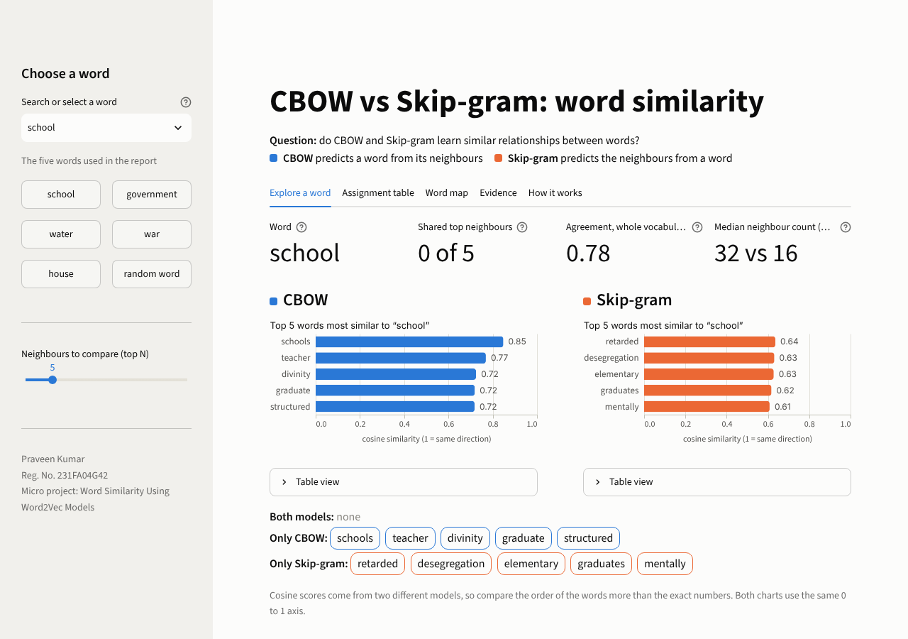
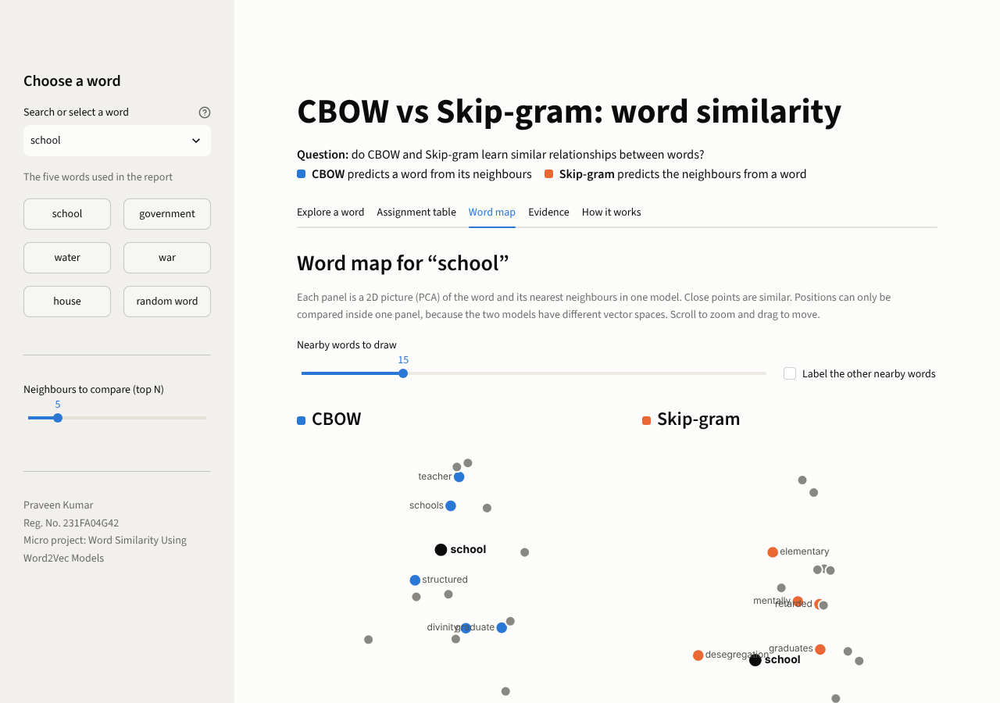
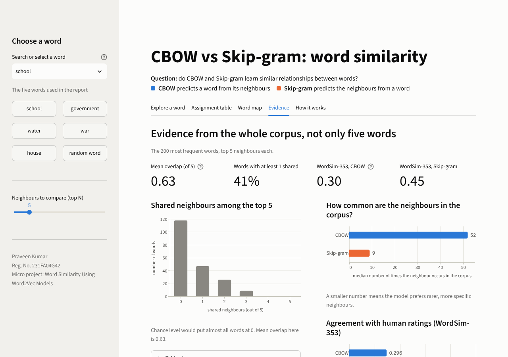

# Word Similarity Using Word2Vec Models: CBOW vs Skip-gram

Micro project (22.10.26 – 25.10.26) · **Praveen Kumar** · Reg. No. **231FA04G42**

> **Research question:** Do CBOW and Skip-gram learn similar relationships between words?

Two Word2Vec models are trained on the same corpus with **identical settings** — the only difference is the `sg` flag — and then compared across multiple levels of evidence.

---

## Results at a glance

| Word | Frequency | CBOW top 5 | Skip-gram top 5 | Common | Overlap |
|---|---|---|---|---|---|
| school | 502 | schools, teacher, divinity, graduate, structured | retarded, desegregation, elementary, graduates, mentally | — | 0/5 |
| government | 432 | constitution, foreign, governments, coalition, abolish | belgian, governments, balafrej, currency, yugoslavia | governments | 1/5 |
| water | 442 | ice, hot, salt, cooled, soil | rinse, bucket, frontage, boil, reservoir | — | 0/5 |
| war | 482 | renowned, battle, citizen, civil, wars | civil, fronts, korean, custer, propaganda | civil | 1/5 |
| house | 573 | sox, hotel, mob, kent, apartment | siding, coffin, barber, livery, fireplace | — | 0/5 |

### Key findings

- **Top-5 neighbour lists are mostly different:** only 2 of 25 slots are shared across the five selected words.
- **Broad vocabulary agreement is high:** Spearman correlation between the two models' full-vocabulary similarity rankings is 0.715–0.809, showing they understand word relationships similarly even when their top-N lists diverge.
- **Mean top-5 overlap over 200 most frequent words:** 0.63 / 5 — far above the chance level of 0.002, but 59% of words share zero top-5 neighbours.
- **CBOW** favours frequent, general neighbours (median corpus count: 52; mean cosine: 0.718).
- **Skip-gram** favours rarer, more specific neighbours (median corpus count: 9; mean cosine: 0.521).
- **Skip-gram aligns better with human judgements:** WordSim-353 Spearman 0.446 vs CBOW's 0.296.
- **Skip-gram is ~2.7× slower to train:** 81.9 s vs 29.8 s (gensim 4.4.0 on the project machine).

Full explanation: [`docs/results_explanation.md`](docs/results_explanation.md)

---

## Interactive web app

Run the app and explore any word in the vocabulary interactively:

```bash
streamlit run app.py
```

The app auto-loads saved models from `models/`, or trains them on the first start (~1–2 minutes).

| Tab | What it shows |
|---|---|
| **Explore a word** | Top-N neighbours for any vocabulary word as side-by-side bar charts. Shared neighbours are marked ◆. Metrics: corpus frequency, shared neighbour count, Spearman agreement, median neighbour frequency. |
| **Assignment table** | The required comparison table for any words you choose, with CSV download and a common-neighbours bar chart. |
| **Word map** | Interactive 2D PCA projection of a word and its nearest neighbours in each model. Drag to pan, scroll to zoom. Hover for cosine and corpus count. |
| **Evidence** | Overlap distribution over the 200 most frequent words, neighbour corpus-frequency comparison, WordSim-353 Spearman test, full corpus and model-settings tables. |
| **How it works** | Type any sentence and choose a window size. Displays the exact training examples CBOW and Skip-gram would generate from it, with a live count of how many more examples Skip-gram creates. |

**Colour code:** blue (`#2a78d6`) = CBOW everywhere, orange (`#eb6834`) = Skip-gram everywhere. The app automatically switches between light and dark themes.





---

## Project structure

```
word2vec-cbow-vs-skipgram/
│
├── README.md                         this file
├── main.py                           CLI pipeline: preprocess → train → compare → results/
├── app.py                            Streamlit interactive web app (5 tabs)
│
├── .streamlit/
│   └── config.toml                   app theming (light + dark, CBOW/Skip-gram colours)
│
├── requirements.txt                  library dependencies (flexible versions)
├── requirements-lock.txt             exact pinned versions (tested)
│
├── src/
│   ├── __init__.py
│   ├── config.py                     all settings in one place (paths, W2V_PARAMS, constants)
│   ├── data.py                       reads the Brown Corpus zip, strips POS tags
│   ├── preprocess.py                 5-step cleaning pipeline + corpus statistics
│   ├── train.py                      trains CBOW and Skip-gram; saves/loads with version check
│   ├── compare.py                    comparison table, overlap, Spearman agreement, WordSim-353
│   └── viz.py                        data helpers for the app: PCA map, neighbour frames, demo
│
├── data/
│   ├── raw/brown.zip                 Brown Corpus (bundled; no download required)
│   └── processed/brown_sentences.txt cleaned sentences, one per line (space-separated tokens)
│
├── models/                           saved models (committed; loads instantly on Streamlit Cloud)
│   ├── cbow.model
│   └── skipgram.model
│
├── results/                          all output files (committed)
│   ├── comparison_table.csv          top-5 neighbours for the 5 selected words
│   ├── neighbours_with_scores.csv    long-format table: word, model, rank, neighbour, cosine
│   ├── corpus_stats.json             corpus size and cleaning statistics
│   ├── model_settings.json           both models' hyperparameters + training timings
│   └── extra_evidence.json           overlap summary, agreement scores, neighbour profiles, WordSim-353
│
├── notebooks/
│   └── word2vec_comparison.ipynb     step-by-step notebook with outputs included
│
├── docs/
│   ├── corpus_description.md         full corpus description for submission
│   ├── model_settings.md             full model settings for submission
│   ├── results_explanation.md        explanation of all findings
│   ├── viva_guide.md                 expected Q&A for the oral defence
│   └── images/                       app screenshots (explore, word map, evidence)
│
└── tests/
    └── test_project.py               9 unit tests (no real corpus or saved models needed)
```

---

## How to run

**Python 3.10 – 3.13 required.** gensim has no Python 3.14 wheel yet (checked October 2026). If your system Python is 3.14, follow the `uv` steps below.

```bash
# 1. Create and activate a virtual environment
python -m venv .venv
.venv\Scripts\activate            # Windows PowerShell
# source .venv/bin/activate       # Linux / macOS

# 2. Install dependencies
pip install -r requirements.txt

# 3a. Interactive web app (trains models on first start, ~1–2 minutes)
streamlit run app.py

# 3b. Step-by-step notebook
jupyter notebook notebooks/word2vec_comparison.ipynb

# 3c. Full CLI pipeline (~1 minute; writes results/ and models/)
python main.py

# 4. Optional: run the tests
python -m pytest -q
```

No internet connection is required — the Brown Corpus zip is bundled in `data/raw/`. If Streamlit prompts for an email on first launch, press Enter to skip.

Running `python main.py` rewrites all files in `results/` and saves the models to `models/`. The web app then loads those models instantly on subsequent starts.

### Python 3.14 workaround (Windows PowerShell)

```powershell
winget install --id astral-sh.uv -e
# Open a new terminal (or refresh PATH), then from the project folder:
uv venv --python 3.12 .venv
.venv\Scripts\activate
uv pip install -r requirements.txt
streamlit run app.py
```

`uv` creates an isolated Python 3.12 environment inside `.venv`. Your system Python 3.14 is not affected.

---

## Method

### 1. Corpus

**Brown Corpus** (Francis & Kucera, 1964 / revised 1979). 500 text samples across 15 genres of edited American English (press reportage, editorial, religion, government, science, fiction, romance, and others). Stored as `data/raw/brown.zip` (sourced from the NLTK GitHub repository).

| Statistic | Value |
|---|---|
| Text samples | 500 |
| Genres (letters a–r, excluding i, o, q) | 15 |
| Raw sentences | 57,340 |
| Raw tokens (incl. punctuation / POS tags) | 1,161,192 |
| Sentences kept after cleaning | 44,509 |
| Tokens after cleaning | 448,314 |
| Full vocabulary size | 40,209 |
| Vocabulary with count ≥ 5 (used by models) | 12,982 |
| Average sentence length (cleaned) | 10.07 tokens |

### 2. Preprocessing

Five steps applied in order (`src/preprocess.py`):

1. **Lowercase** every word.
2. **Letters only** — split on any non-letter character (`[^a-z]+`). Handles hyphens (`term-end` → `term`, `end`), apostrophes (`Atlanta's` → `atlanta`, `s`), and digits.
3. **Minimum token length** — drop tokens shorter than 3 characters.
4. **Stop-word removal** — drop words in scikit-learn's 318-word English stop-word list.
5. **Minimum sentence length** — drop sentences with fewer than 4 remaining tokens.

The cleaned sentences are saved to `data/processed/brown_sentences.txt` (one sentence per line).

### 3. Model settings

Both models use `gensim.models.Word2Vec` with **identical hyperparameters**. The only difference is `sg`:

| Parameter | CBOW | Skip-gram | Notes |
|---|---|---|---|
| `sg` | **0** | **1** | 0 = CBOW, 1 = Skip-gram |
| `vector_size` | 100 | 100 | Embedding dimensionality |
| `window` | 5 | 5 | Context words on each side of the centre word |
| `min_count` | 5 | 5 | Ignore words appearing fewer than 5 times |
| `epochs` | 20 | 20 | Training passes (5× gensim's default of 5) |
| `negative` | 5 | 5 | Negative samples per positive example |
| `sample` | 0.001 | 0.001 | Down-sampling rate for frequent words |
| `alpha` | 0.025 | 0.025 | Initial learning rate (gensim default) |
| `min_alpha` | 0.0001 | 0.0001 | Final learning rate (gensim default) |
| `workers` | 1 | 1 | Single thread — ensures reproducibility with fixed seed |
| `seed` | 42 | 42 | Fixed random seed |
| Vocabulary | 12,982 | 12,982 | Identical (same corpus, same `min_count`) |

**Training time:** CBOW 29.8 s, Skip-gram 81.9 s (~2.7× slower because Skip-gram creates one training example per (centre, context) pair, while CBOW creates one example per centre word).

Full settings documentation: [`docs/model_settings.md`](docs/model_settings.md)

### 4. Words selected for comparison

`school`, `government`, `water`, `war`, `house` — five frequent nouns chosen from different topic domains (education, politics, nature, conflict, everyday life). All appear within the 100 most frequent words of the cleaned corpus.

### 5. Evidence levels

| Evidence | Method | Output |
|---|---|---|
| Top-5 comparison table | `compare.comparison_table()` | `results/comparison_table.csv` |
| Cosine scores per neighbour | `compare.neighbours_with_scores()` | [`results/neighbours_with_scores.csv`](results/neighbours_with_scores.csv) |
| Overlap over 200 most frequent words | `compare.overlap_summary()` | `results/extra_evidence.json` |
| Whole-vocabulary Spearman agreement | `compare.similarity_agreement()` | `results/extra_evidence.json` |
| Neighbour frequency profile | `compare.neighbour_profile()` | `results/extra_evidence.json` |
| WordSim-353 human-judgement test | `compare.wordsim_evaluation()` | `results/extra_evidence.json` |

---

## Quantitative results

### Overlap over 200 most frequent words (top 5)

| Metric | Value |
|---|---|
| Mean overlap | 0.63 / 5 |
| Chance level (expected at random) | 0.002 |
| Words with ≥ 1 shared neighbour | 41% |
| Words with ≥ 3 shared neighbours | 4.5% |
| Words with 0 shared neighbours | 59% |

### Spearman agreement (full vocabulary)

| Word | Spearman ρ |
|---|---|
| government | 0.809 |
| school | 0.785 |
| house | 0.785 |
| war | 0.729 |
| water | 0.715 |

### Neighbour frequency profile (200 most frequent words)

| Model | Median neighbour corpus count | Mean top-5 cosine |
|---|---|---|
| CBOW | 52 | 0.718 |
| Skip-gram | 9 | 0.521 |

### WordSim-353 (human-rated word similarity)

| Model | Spearman ρ | Pearson r | Pairs covered |
|---|---|---|---|
| Skip-gram | **0.446** | 0.445 | 75.4% |
| CBOW | 0.296 | 0.301 | 75.4% |

---

## Source code overview

| File | What it does |
|---|---|
| `src/config.py` | Single source of truth for all settings: paths, `W2V_PARAMS` dict, `SELECTED_WORDS`, `TOPN`, `N_FREQUENT_FOR_OVERLAP`. The `sg` key is deliberately absent from `W2V_PARAMS` so it cannot accidentally be shared. |
| `src/data.py` | Opens `brown.zip`, iterates files matching the Brown naming pattern (`c[a-z]\d\d`), decodes as `latin-1`, strips POS tags (splits on `/`, keeps the word), yields `(file_name, word_list)`. Falls back to downloading the zip from NLTK GitHub if it is missing. |
| `src/preprocess.py` | Applies the 5-step cleaning pipeline, collects per-genre sentence counts, returns `(sentences, stats)`. Also provides `save_sentences()` / `load_sentences()` for the processed text and `save_stats()` for JSON output. |
| `src/train.py` | `train_models()` trains CBOW then Skip-gram sequentially and records wall-clock timings. `load_models()` verifies that saved hyperparameters match `config.W2V_PARAMS` before returning them — if settings have changed it returns `None` to force retraining. |
| `src/compare.py` | Six analysis functions: comparison table, long-format scores CSV, overlap summary with chance-level reference, whole-vocabulary Spearman agreement, neighbour corpus-frequency profile, WordSim-353 evaluation. |
| `src/viz.py` | Data helpers for `app.py` (no Streamlit imports): `neighbour_frame()`, `compare_word()`, `pca_map()` (2D PCA with explained-variance ratio), `demo_tokens()`, `training_examples()` (CBOW and Skip-gram examples from a user sentence). |
| `main.py` | CLI entry point. Four steps: clean corpus → train models → build comparison table → write extra evidence. All output goes to `results/`. |
| `app.py` | Streamlit app. Smart caching with `@st.cache_resource` (models) and `@st.cache_data` (analysis). Light/dark-aware colour palette. Five tabs as described above. |

---

## Tests

`tests/test_project.py` contains 9 unit tests that run in under a minute using toy corpora (no real corpus or saved models required):

| Test | What it verifies |
|---|---|
| `test_clean_sentence_rules` | Lowercase, letter-only tokenisation, minimum token length, stopword removal |
| `test_hyphen_is_split` | `term-end` → `["term", "end"]` |
| `test_shared_settings_do_not_contain_sg` | `sg` is absent from `config.W2V_PARAMS` |
| `test_models_differ_only_in_sg` | Toy CBOW and Skip-gram share all settings except `sg` |
| `test_overlap_is_between_zero_and_k` | `overlap_at_k()` returns a value in `[0, k]` |
| `test_training_examples_for_the_assignment_sentence` | "Students learn programming in college." → 5 CBOW examples, 14 Skip-gram examples |
| `test_compare_word_and_frame_shapes` | `viz.compare_word()` returns correctly shaped DataFrames |
| `test_pca_map_has_target_and_neighbours` | `viz.pca_map()` returns correct structure and explained-variance ratio |
| `test_load_models_returns_none_when_missing` | `train.load_models()` returns `None` when the models directory is empty |

---

## Dependencies

### `requirements.txt` (flexible)

```
gensim>=4.3
numpy>=1.24
pandas>=2.0
scikit-learn>=1.3
scipy>=1.10
streamlit>=1.50
altair>=5
jupyter
ipykernel
nbformat
pytest
```

### `requirements-lock.txt` (pinned, tested)

| Library | Version |
|---|---|
| gensim | 4.4.0 |
| numpy | 2.5.4 |
| pandas | 3.0.6 |
| scikit-learn | 1.9.1 |
| scipy | 1.18.1 |
| streamlit | 1.66.1 |
| altair | 6.3.0 |
| jupyter | 1.1.1 |
| ipykernel | 7.4.0 |
| nbformat | 5.11.1 |
| nbconvert | 7.17.2 |
| pytest | 9.1.1 |

---

## Reproducibility

`workers=1` and `seed=42` make results repeatable. The pipeline produced identical neighbours and cosine scores across every run on the development machine (gensim 4.4.0, numpy 2.5.4). A different gensim or numpy version may shift some scores slightly. Use `requirements-lock.txt` to reproduce exactly.

---

## Submitted items

| Required item | Location |
|---|---|
| Python notebook | [`notebooks/word2vec_comparison.ipynb`](notebooks/word2vec_comparison.ipynb) (outputs included) |
| Corpus description | [`docs/corpus_description.md`](docs/corpus_description.md) |
| Model settings | [`docs/model_settings.md`](docs/model_settings.md) |
| Comparison table | notebook section 5, and [`results/comparison_table.csv`](results/comparison_table.csv) |
| Results explanation | notebook section 8, and [`docs/results_explanation.md`](docs/results_explanation.md) |

Also included: interactive web app (`app.py`) and [`docs/viva_guide.md`](docs/viva_guide.md) with anticipated viva questions and answers.

---

## Limitations

- **Small corpus:** ~448K tokens is on the low end for Word2Vec. Rare-word vectors (e.g. *balafrej*) can be noisy.
- **One random seed:** results may vary slightly with a different seed.
- **One hyperparameter set:** `window`, `vector_size`, and `epochs` are fixed.
- **Stopwords removed:** some grammatical relationships are lost.
- **Ambiguous words:** *house* (building / political house / music) picks up different senses depending on context.

---

## Possible extensions

- Repeat with multiple random seeds and report variance.
- Vary `window` (2 vs 5 vs 10) or `vector_size` (50 vs 100 vs 300) and compare.
- Replace PCA with t-SNE or UMAP for the word map.
- Train on a larger corpus (e.g. Wikipedia) for more stable rare-word vectors.
- Add analogy evaluation (`king − man + woman = queen`).

---

## Data and credits

- **Brown Corpus:** W. N. Francis and H. Kucera, Brown University (1964, revised 1971 and 1979). Redistribution permitted by its README. Zip sourced from the NLTK data repository (`nltk/nltk_data`).
- **Word2Vec algorithm:** Mikolov et al. (2013), *Efficient Estimation of Word Representations in Vector Space*. arXiv:1301.3781.
- **gensim:** Řehůřek and Sojka (2010). WordSim-353 dataset (Finkelstein et al., 2002) is bundled with gensim.
- **scikit-learn stop-word list:** Pedregosa et al. (2011), *Scikit-learn: Machine Learning in Python*. JMLR 12:2825–2830.
